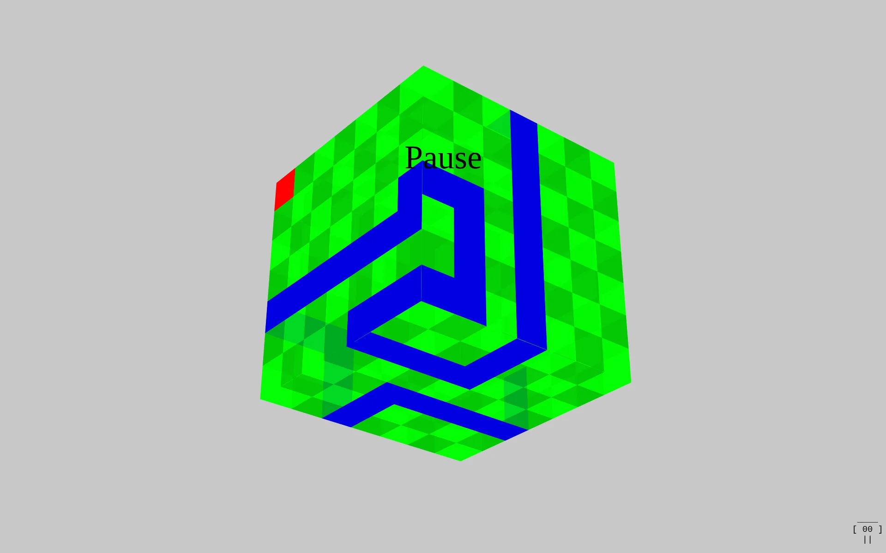

# Snake Games
This is a collection of Snake games.

## Why Snake?
I have always loved the Snake game because of its simplicity to code and play. Recently when playing Snake, I thought of some fun ways to modify the original game. This program contains those ideas.

## Get Started
To play, click one of the buttons on the left side of the screen bellow the 'Snake Games' header. There is a setting button to the left of the blue title. When clicked you have the option to change things like the number of food. When playing any of the games, you can press the space key to pause.

# The Games
I have not fully tested all of the games but The first three (original, multi, and 3D) should all work.

## Original
This is the original snake game, to play use the arrow keys. Make sure you do not hit the walls or yourself.

## Multi
Use the arrow keys to avoid the other snakes. The field is limited, although you can not see all of it. Get as big as possible by eating the food.

## 3D
The cube can be moved by using the 'wasd' keys. The arrow keys move the snake around the outside of the cube. 

## Portal
Using the arrow keys, a snake is moved around multiple fields connected by portals. Portals of the same color connect and the black walls are not portals and can not be hit.

#
NOTE: This project is not done yet. I am still working on the project and there may be bugs or features that do not work. Thanks for your understanding.

Play the game here: https://ecarlson8673-crypto.github.io/Snake/